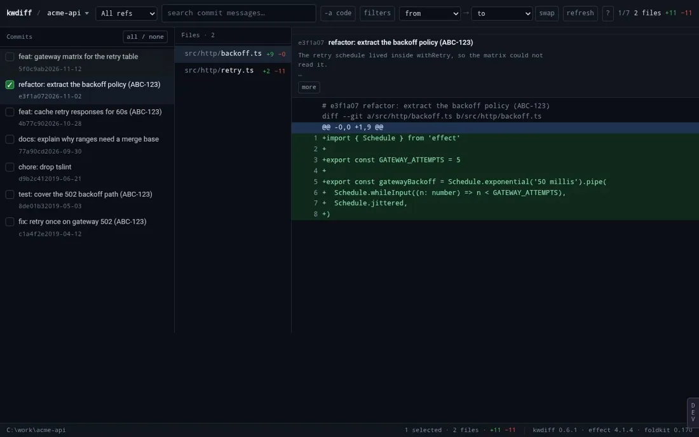

# kwdiff — a review window for branches that share no ancestor

*For kwdiff 0.8.0 · Windows 10 or 11, 64-bit · needs git 2.28 or newer*

## What it is

kwdiff is a reader for changes you have to review across branches that have
nothing in common: a 2019 SVN import next to `main`, a vendored history, an
orphan branch, two release lines that diverged years ago. Most tools ask git for
a *range*, and a range needs a common ancestor — on unrelated branches `git log
A..B` quietly means "everything in B", so the wrong answer is invisible.

kwdiff asks a different question: which commits do you want to read, and what
does each one change against **its own parent**? That needs no ancestor, so a
list of commits from any number of roots can be read together, and two arbitrary
tips can be compared as two trees.

It never changes your repository. No checkout, no staging, no commits, no
merges: it runs `git log`, `git show`, `git diff` and `git grep`, and shows you
the text.

## Install

1. Download `kwdiff_0.7.0_x64-setup.exe` from the release page and run it.
2. Windows will warn that the app is unsigned (*Windows protected your PC*).
   Choose **More info → Run anyway**. It is unsigned on purpose — signing is
   later work — so the warning is expected, once per download.
3. It needs `git` on your `PATH`; nothing else.

## First launch

kwdiff reopens the last repository you used, or shows a card with *Open
repository…* and your recent ones. You can point it at **any folder inside a
repository** — it resolves the root upward, the way git does. Dropping a folder
on the window opens it too.

Three panes: **commits** on the left, the **files** those commits touch in the
middle, the **patch** of the selected file on the right. The commit's message
body sits above the patch.

## Five things you will do

### Find commits by message

Type in the search field. After a quarter of a second the list narrows to
commits whose message contains what you typed — case-insensitive, across every
ref, newest first, up to 2 000 commits. Leave the field empty to list
everything.

### Narrow by author, path or date

Click **filters**. Four more limits, all passed straight to `git log`:

- **author** — part of a name or address;
- **path** — a directory or file path, e.g. `src/http`;
- **since** / **until** — dates; "until" includes its whole day;
- **regex** — off by default, so `a.b` finds `a.b` and not `axb`; on, the
  keyword and the author are regular expressions.

The button counts what is on, *Clear filters* removes it, and filters are not
remembered between launches.

### Read a commit's patch

Tick a commit (`space` or a click), pick a file in the middle pane, read the
patch. Shift-click or shift-arrow selects a range of commits and shows their
files together — that is the cross-root case the app exists for. When the
selection spans unrelated roots, a divider says so.

The patch has line numbers in a quiet gutter, and its hunks are highlighted as
you move through them.

### Compare two tips

The two slots beside the search field answer "what changed between these two?".
Pick a ref in each (or put the commit under the cursor in one with `f` / `t`;
`x` swaps them). Both slots filled is a tree diff: unrelated roots are fine, and
the divider only appears when the two endpoints really cannot share an ancestor.
Empty a slot to return to the ticks you had before.

### Jump to where a code match is

Turn on **`-a code`** and search for something that appears in a *changed line*.
Ticking such a commit opens the file that contains the match (a dot marks it in
the file list) and scrolls the patch to the hunk that matched.

## Keeping it current

- **`refresh`** (or `r`) after a `git fetch`: it re-reads the refs and runs the
  query again. Ticks, filters and the compare pair survive.
- **The name in the top bar** opens the picker and your recents, so switching
  repositories does not need a restart.

## Keys

| Key | What it does |
| --- | --- |
| `/` | jump to the search field |
| `j` / `k`, `↓` / `↑` | move inside the focused pane; scroll **lines** in the patch |
| `space` | tick or untick the commit under the cursor |
| `shift`+click, `shift`+`↓` | extend the selection from the anchor |
| `tab` / `shift`+`tab` | next / previous pane |
| `enter` | one pane deeper |
| `esc` | one pane back, or close the keymap, filters or repository row |
| `n` / `p` | next / previous **hunk** |
| `g` / `shift`+`g` | first / last hunk |
| `f` / `t` | use the commit under the cursor as the compare from / to |
| `x` | swap the compared endpoints |
| `r` | refresh refs and results |
| `?` or `F1` | the key list |

## When it looks wrong

| What you see | What it is |
| --- | --- |
| *Windows protected your PC* | the app is unsigned: **More info → Run anyway** |
| *git is not on PATH* | install git 2.28+ and reopen |
| *Could not open that repository* | the folder is not inside a repository |
| An empty list with a keyword | no match on this ref — the message names the keyword, or the filter count, and *Clear filters* / *Search all refs* are one click |
| *No changes between X and Y* | the two endpoints have the same tree |
| Results feel old after a pull | press `r` |

## What it deliberately does not do

No exporting or copying patches, no review notes yet, no staging, committing or
merging, no commit graph, no blame, no PR hosting integration, no tabs for
several repositories, no plugins, no telemetry. Each was a decision, not an
omission — the reasoning is in `docs/spec.md`.

## Limits worth knowing

- 2 000 commits per search; narrow with a keyword or the filters.
- One file's patch at a time. Past 5 000 lines the pane shows the first 5 000
  with a **show all** button; a very large patch takes a moment to paint.
- Windows 10/11 only, 64-bit.

## Telling me what you think

Anything that surprised you, anything you reached for that was not there, and
any patch that rendered wrong — with the repository and commit if you can. That
list decides what 1.0 contains.
